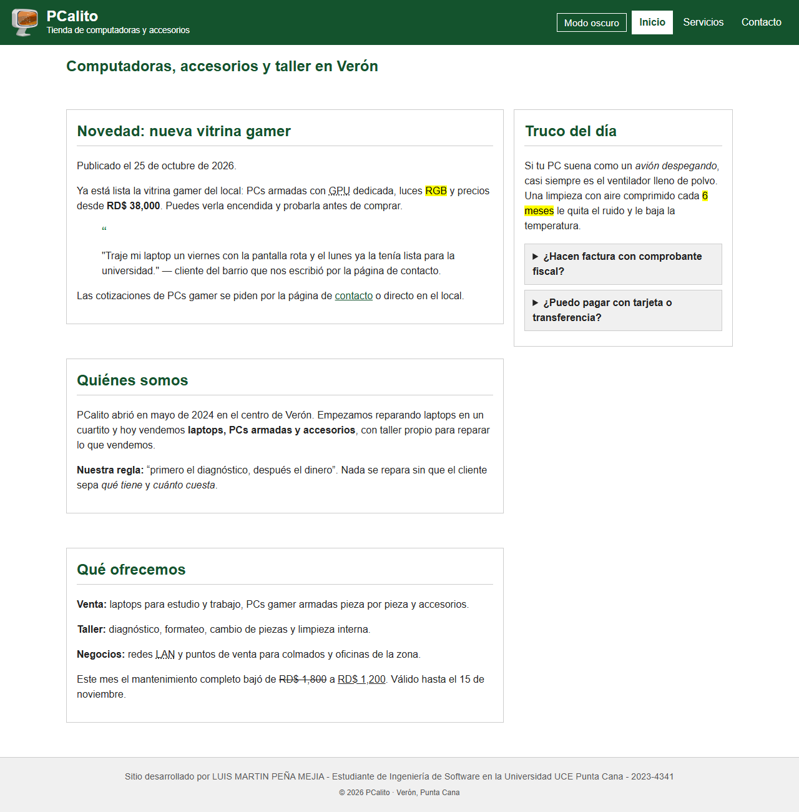
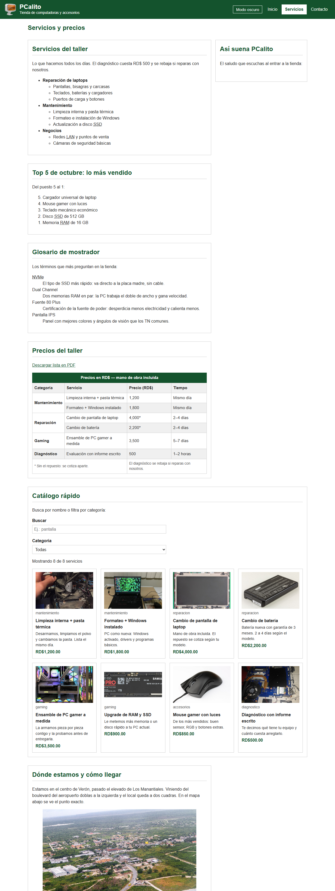
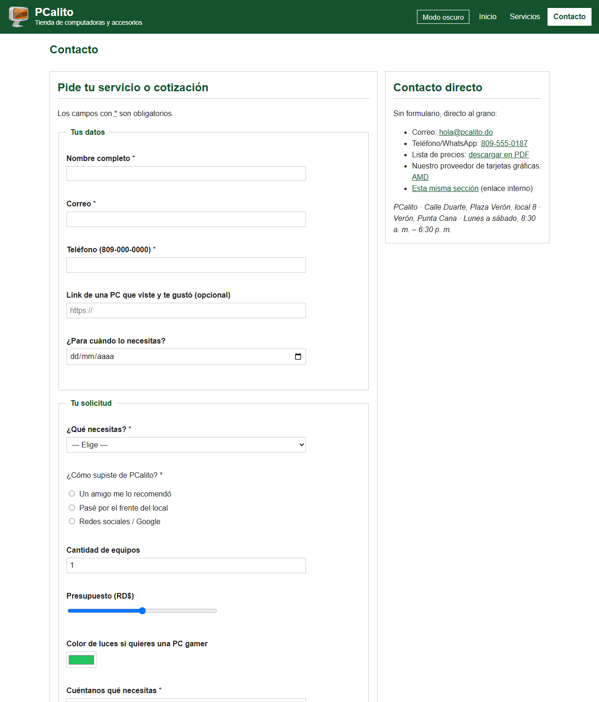
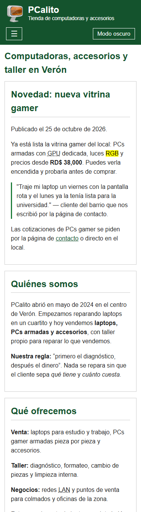
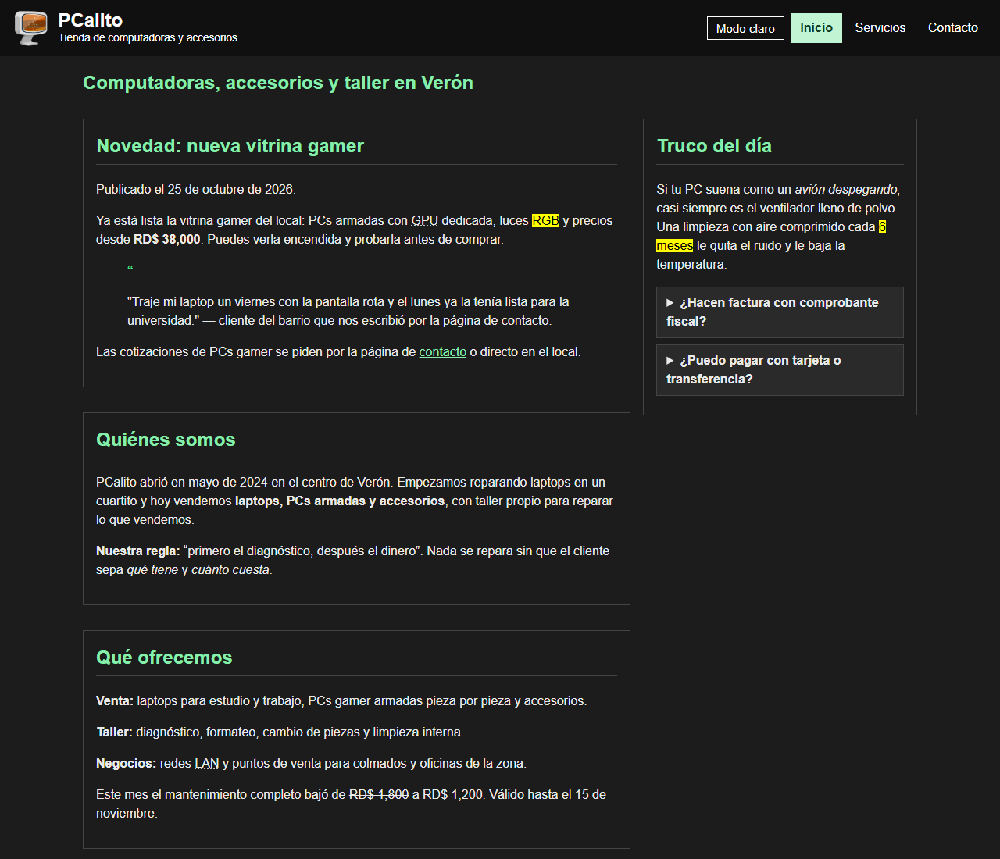

# PCalito - Tienda de computadoras

Este es el sitio de PCalito, una tienda de computadoras y accesorios que
queda en el centro de Verón, Punta Cana. Venden laptops y PCs armadas,
hay taller propio para reparaciones y le trabajan a los negocios de la
zona con redes y puntos de venta.

Son 3 páginas en HTML5 puro. Un solo css (`css/estilos.css`) y un solo
js (`js/app.js`). Sin frameworks, todo a mano.

**Sitio:** https://luismartin023.github.io/pcalito/
**Autor:** Luis Martín Peña Mejía · 2023-4341

## Capturas

## Mapa de etiquetas

| Familia | Dónde la usé | Etiquetas | Por qué |
|---|---|---|---|
| Cimientos | las 3 páginas | `doctype`, `html lang`, `meta`, `title`, `link`, `script defer` | lo mínimo que toda página lleva |
| Encabezados y párrafos | todas las secciones | `h1` a `h3`, `p` | un `h1` por página y sin saltos de nivel |
| Texto citas y código | index, la noticia y las reglas | `strong`, `em`, `mark`, `del`, `ins`, `abbr`, `q`, `small`, `blockquote`+`cite`, `time` | el precio rebajado es un cambio real (`del`/`ins`) y las siglas van con `abbr` |
| Listas | servicios | `ul` con sublista, `ol reversed`, `dl` con 4 términos | cada lista es distinta: categorías, top 5 y glosario |
| Enlaces | contacto | externo con `rel="noopener"`, `mailto:`, `tel:`, `#id`, `download` | los 5 tipos que pedía la tarea, cada uno con uso real |
| Imágenes y multimedia | las 3 y servicios | `img`, `figure`+`figcaption`, `iframe`, `audio`+`source` | el logo de la tienda en el header, las fotos de los servicios, la vista de Verón con pie, el mapa con `title` y el saludo en audio |
| Tablas | servicios, precios | `table`, `caption`, `thead`, `tbody`, `tfoot`, `th scope`, `colspan`, `rowspan` | los precios son datos tabulares y las categorías comparten filas con `rowspan` |
| Formularios | contacto | `form`, `fieldset`+`legend`, `label for`, 10 tipos de `input`, `select`+`optgroup`, `textarea`, `button`, `span.error` | el formulario pide el servicio y cada campo lleva su span para el error |
| Semántica y div/span | las 3 | `header`, `nav`, `main`, `section`, `article`, `aside`, `footer`, `address`, `details`+`summary`, `div`, `span` | `article` para la noticia, `aside` para el truco, `address` para la tienda |

## Lo que hace el JavaScript

| Funcionalidad | Página | Evento | Cómo lo hice |
|---|---|---|---|
| Menú hamburguesa | las 3 | click | `classList.toggle('abierto')` y actualiza `aria-expanded` |
| Modo oscuro | las 3 | click | `aplicarTema()` y se guarda en `localStorage` |
| Año automático | las 3 | al cargar | `new Date().getFullYear()` en el span `#anio` |
| Botón subir | las 3 | scroll + click | sale al bajar y sube con `scrollTo` |
| Catálogo dinámico | servicios | input + change | `pintarTarjetas()` y `filtrar()` sobre el arreglo |
| Contador y buscador | servicios | input | `filter()` por texto y categoría |
| Validación del form | contacto | submit + input | `preventDefault()`, reglas propias y mensajes en `.error` |
| Resumen de envío | contacto | submit ok | escribe el resumen en `#resumen` y hace `reset()` |

## Cómo correrlo

Abrir `index.html` con Live Server o entrar al link de arriba.
